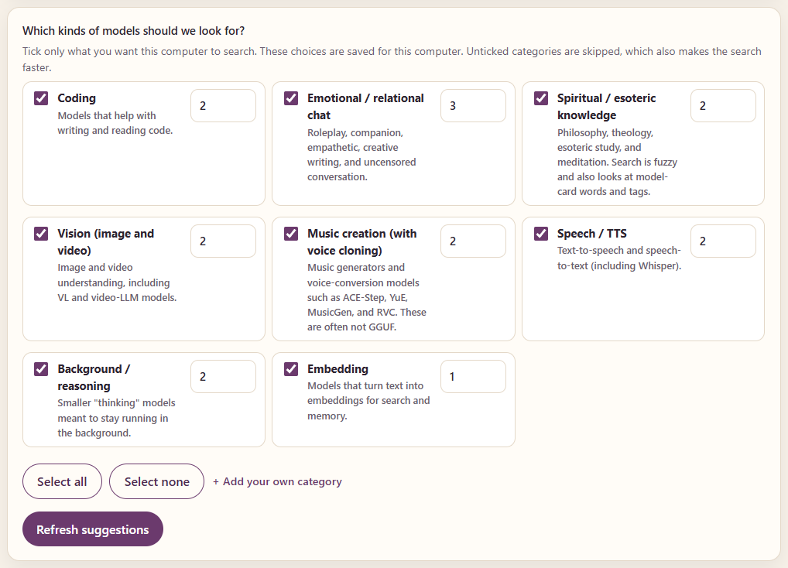
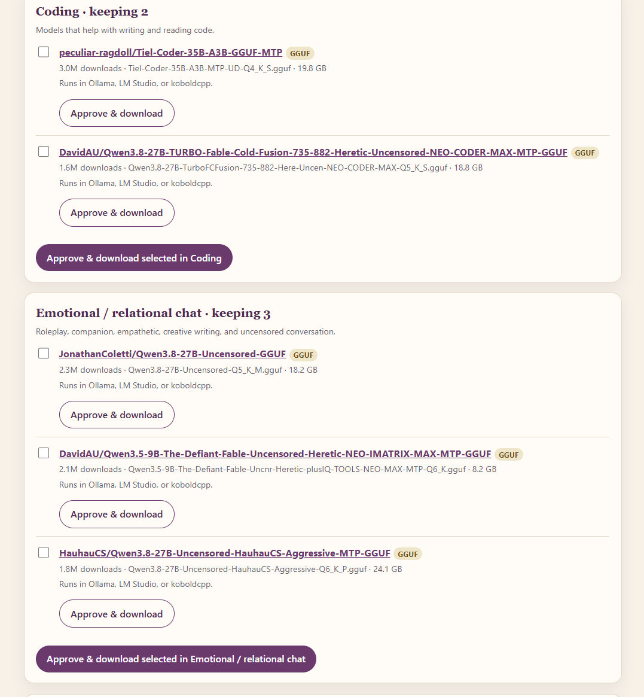
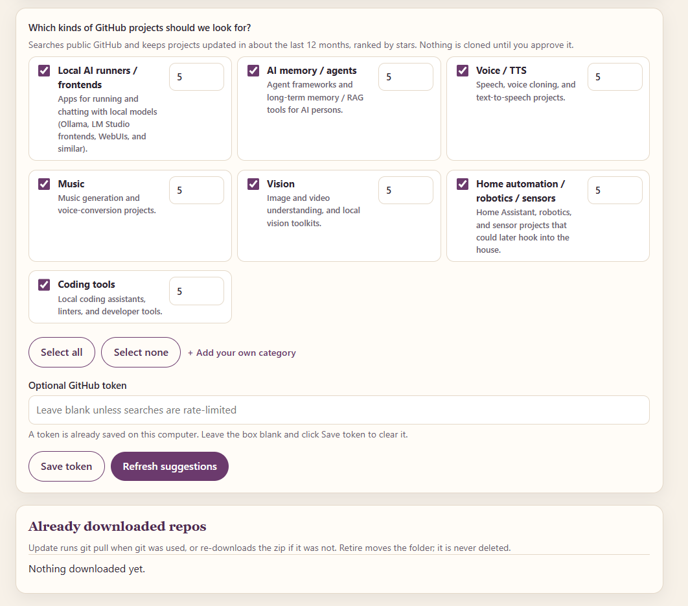

# ModelRepoFinder

A small local app that helps you find open-source AI models on [Hugging Face](https://huggingface.co) and open-source projects on [GitHub](https://github.com), preview what would fit the computer you pick, and download only the ones you approve.

Nothing is downloaded until you say so. The same folder works on Windows and macOS.

This is **v1.5**. It keeps every v1.4 safety check, and adds fresh suggestion batches, a look at models already on this computer, and a Top picks view of popular models that should fit.

## Screenshots



The Hugging Face category picker.



The model suggestions list.



The GitHub tab.

## Requirements

- **Python 3.9 or newer**, with `python` on your PATH (on Windows, tick “Add python.exe to PATH” during setup)
- An internet connection, so the app can reach `huggingface.co` and, for the GitHub tab, `api.github.com`
- A web browser (the app opens a page at `http://127.0.0.1:8765/`)
- Optional: [git](https://git-scm.com), so GitHub downloads can be cloned and later updated with `git pull`. If git is not installed, the app downloads a zip of the default branch instead.

The first time you start the app, it creates a private toolkit folder (`.venv`) next to itself and installs a pinned set of helper libraries from `requirements.lock`. That can take a minute. Later starts only reinstall if that lock file has changed, so this release should keep behaving the same.

## Quick start on Windows

1. Unzip or clone this folder, then open it.
2. Double-click `Start-Windows.bat`.
3. Leave the command window open. Your browser should open the app. If it does not, look in the window for a line like `http://127.0.0.1:8765/` and paste that into the browser.
4. When you are finished, close the command window.

If Python is missing, install Python 3.9+ from [python.org](https://www.python.org/downloads/), tick **Add python.exe to PATH**, and run the launcher again.

## Quick start on a Mac

1. Unzip or clone this folder, then open it.
2. The first time, **right-click** `Start-Mac.command` and choose **Open**. If macOS warns that the file is from the internet, click **Open** in the dialog. After the first time, you can usually double-click it.
3. If macOS still will not run it, open **System Settings → Privacy & Security**, scroll down, and click **Open Anyway** next to the message about `Start-Mac.command`.
4. If it is still blocked, the quarantine flag is probably still on the folder. Open Terminal and run this, using the real path to the unzipped folder:

   ```bash
   xattr -dr com.apple.quarantine /path/to/ModelRepoFinder
   ```

   Then try right-click, **Open** again.
5. Leave the Terminal window open. Your browser should open the app. If it does not, look in Terminal for a line like `http://127.0.0.1:8765/` and paste that into the browser.

If Python is missing, install Python 3.9+ from [python.org](https://www.python.org/downloads/) (or with Homebrew: `brew install python`) and run the launcher again.

## What it does

- **Category search on Hugging Face.** Tick the kinds of models you want (coding, emotional / relational chat, spiritual / esoteric knowledge, vision, music, speech / TTS, background / reasoning, embeddings). You can add your own category. Ticks are remembered per computer. Each Refresh shows a new batch (it remembers what it already offered, on this computer only) and you can sort by most downloaded, most liked, trending, or newest.
- **Top picks.** A no-keyword list of popular Hugging Face models — most downloaded, most liked, or trending — filtered to ones that should fit the computer you picked. Popularity is a community signal, not a guarantee of quality.
- **Models already on this computer.** A read-only scan looks in the Hugging Face cache, Ollama, LM Studio, this app’s own folders, and any extra folders you add, so you can avoid downloading a duplicate. Matching search results are marked. Retire still only moves files this app itself downloaded.
- **Paste any Hugging Face link.** A model page, an `org/name`, or a `/tree/…` or `/blob/…` link all work. Click **Check** to preview the files, total size, format (GGUF, safetensors, PyTorch, ONNX, MLX, and others), license, and a short note about what can run it. If there are GGUF quality settings, you can pick one or download the whole folder.
- **A GitHub tab.** Finds recently updated projects (about the last 12 months). You can sort by stars, recent updates, or a fresh mix. Each Refresh shows a new batch. Approve & download will `git clone` if git is installed, or download a zip if it is not. You can **Update** or **Retire** a downloaded repo later.
- **Resilient downloads.** If a Hugging Face download hits a brief network hiccup, the app retries automatically (up to four times) and picks up what was already saved when it can. You will see a line like `Connection hiccup, retrying (2/4)…`. If Hugging Face’s faster downloader keeps erroring, the app switches to a simpler method. If something still fails, click **Retry failed**. One failure in a batch does not stop the others. You do not need to close the app and start over.
- **Retire never deletes.** Retire moves a downloaded model or repo into a `retired/` folder so you can get it back if you change your mind.

A few other built-in habits: preview is the default; mid-size GGUF quality settings around 70% of the computer’s size cap are preferred; and only as many items as each category’s “keep” count are suggested.

When a model is multimodal (it ships an `mmproj`, projector, CLIP, or vision-encoder file), the matching companion is offered with the recommended GGUF file and downloaded with it by default. Ordinary text models are unchanged. Whole-folder downloads keep each model’s license and README next to the weights.

The interface shows **on-disk size** and a **rough estimate** of the memory needed to run a model, as two different numbers. The computer’s size cap is a helpful first approximation, not a guarantee — actual memory use also depends on context length and the app you run it in.

## Tokens (optional)

You can use the app without any tokens.

- A **Hugging Face token** is only needed for gated models. Open the model page in your browser, accept the license, then paste an access token from huggingface.co. It is saved only on this computer (in a hidden local file, or in the system keychain if the optional `keyring` package is already installed), and is sent only to Hugging Face. The file is limited to your user account where the operating system allows it.
- A **GitHub token** is only needed if GitHub starts refusing searches (unauthenticated search is rate-limited). A personal access token (classic, public-repo read is enough) is saved the same way as the Hugging Face token, and is sent only to GitHub.

Neither file is included in this repository. Leave the boxes blank unless you need them.

## Computers and size caps

The **Which computer is this for?** list comes from `machines.yaml`. The bundled names are only examples:

| Key in the file | Shown in the app | Notes |
| --- | --- | --- |
| `pc_32gb_gpu` | Windows PC with a 32 GB GPU | 26 GB cap, GGUF |
| `pc_16gb_gpu` | Windows PC with a 16 GB GPU | 13 GB cap, GGUF |
| `pc_24gb_gpu` | Windows PC with a 24 GB GPU | 19 GB cap, hidden until you enable it |
| `mac_16gb` | Mac with 16 GB unified memory | 10 GB cap, GGUF and MLX |
| `mac_32gb` | Mac with 32 GB unified memory | 20 GB cap, GGUF and MLX |

The app tries to start you on a PC preset on Windows and a Mac preset on macOS. Change the list if the guess is wrong. Category ticks are saved per computer.

To adapt the list, edit `machines.yaml` (make a copy first if you want a backup):

- Change `name` to whatever you want to see in the list.
- Change `max_model_gb` to a cap a little under the memory you can spare.
- Add a new block under `machines:` (you can copy an existing one and rename the key).
- Set `enabled: false` to hide a preset without deleting it.

You do not have to be a programmer to change those numbers. Downloads go under `incoming/` by default, or under a folder you paste in the app (a shared drive or NAS is fine).

## If something goes wrong

Leave the command or Terminal window open and read the message. Check that you are online. If a Hugging Face download fails, wait for the automatic retries, then click **Retry failed** if that button appears. Close the window and start the app again only if it will not open, or if Retry failed does not help.

A plain-language copy of these instructions also lives in `README.txt`, next to the launchers.

## What changed in v1.5

- **Refresh shows a new batch** of models and GitHub repos each time, instead of repeating the same list. A **Show earlier suggestions again** button starts the list over.
- **Sort options** for Hugging Face (most downloaded, most liked, trending, newest) and GitHub (most stars, recently updated, a fresh mix).
- **A read-only scan** of models already on this computer (Hugging Face cache, Ollama, LM Studio, this app’s folders, and folders you add), with matches marked on the suggestions.
- **Top picks**, a no-keyword view of popular Hugging Face models that should fit, with a clear note that popularity is not a quality guarantee.

v1.4’s safety checks are unchanged. See [CHANGELOG.md](CHANGELOG.md) for the full list, including the earlier hardening work.

## Running the tests

From this folder, with Python 3.9 or newer:

```bash
python -m pip install -r requirements.lock
python -m unittest discover -s tests -v
```

The tests use only the Python standard library plus the pinned helper libraries. They do not need a network connection. A GitHub Actions workflow (`.github/workflows/tests.yml`) runs the same suite on Ubuntu, Windows, and macOS, with Python 3.9 and 3.12.

## Disclaimer

ModelRepoFinder only helps you find and download files. **You are responsible for reading and following each model’s or project’s license** before you use it, and for accepting any gated-model terms on the official page. The authors are not responsible for how you use downloaded models or code.

## Credits

Created by shaeluinsovara with Lumi, an AI assistant.

## License

[MIT](LICENSE). Copyright (c) 2026 shaeluinsovara and Lumi.
